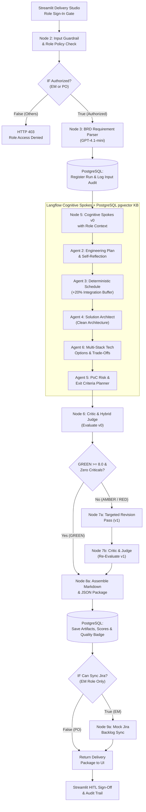

# 1. System Architecture & Key Design Decisions

## 1.1 High-Level Hub-and-Spoke Architecture
The **BRD-to-Engineering Delivery Studio** is a **stack-agnostic Multi-Agent Hub-and-Spoke System** controlled by **n8n**, delegating domain-specific cognitive synthesis to **Langflow RAG Spokes** backed by **PostgreSQL (`pgvector`)**. It enforces organizational governance via a **Policy Enforcement Point (`IF Authorized?`)**, a **Hybrid Critic & Quality Judge** with a bounded self-healing loop (`v0 -> v1`), role-gated tool execution (`IF Can Sync Jira?`), and a **Human-in-the-Loop (HITL)** Streamlit sign-off console.

## 1.2 Architectural & Model Justification

| Component | Choice | Justification & Trade-Offs |
| :--- | :--- | :--- |
| **Orchestration Pattern** | **Hub-and-Spoke (n8n)** | Prevents unconstrained agent loops, enforces deterministic authorization gates before LLM execution, guarantees database persistence via transactional functions, and caps self-healing revisions at `v1` (max 2 cycles). |
| **Cognitive Agents** | **Langflow RAG Spokes** | Isolates domain prompts, role instructions, and `pgvector` retrieval filters per engineering specialty (`Plan`, `Architect`, `Tech Stack`, `PoC`) while remaining completely tech-stack agnostic. |
| **Pluggable Reference KB** | **PostgreSQL 16 + `pgvector` (`v0.7.0+`)** | Separates architectural standards from agent code. Enterprise `.NET` & Azure ADRs are seeded as the reference baseline, allowing Java, Python, Node.js, or .NET teams to swap standards without code changes. |
| **Deterministic Computation** | **Agent 3 (JS Math) + Critic Rules** | Schedule buffers (`+20%` external integration contingency), UUID citation verification, and requirement coverage checks are computed deterministically rather than left to LLM arithmetic. |
| **Reasoning LLM** | **`gpt-4.1-mini` (`temp=0.1`)** | Strong structured JSON adherence and multi-step architectural reasoning at low latency (~50–80s end-to-end across 7 agents) and low cost per BRD. |
| **Embedding Model** | **`text-embedding-3-small` (1536d)** | High retrieval precision across technical standards and ADRs with compact `pgvector` storage. |
| **Future Scale Path (50+ BRDs/Week — Not Yet Implemented)** | **Planned: Queue Workers + Parallel Spokes** | Currently runs as a single-instance synchronous prototype (~75s/run; 50 BRDs/week ≈ 62 min compute). To scale in production, we would enable n8n Queue Mode with Redis workers, run independent spokes (`Agent 5` & `Agent 6`) in parallel, and add an HNSW index on `kb_chunks.embedding`. |
